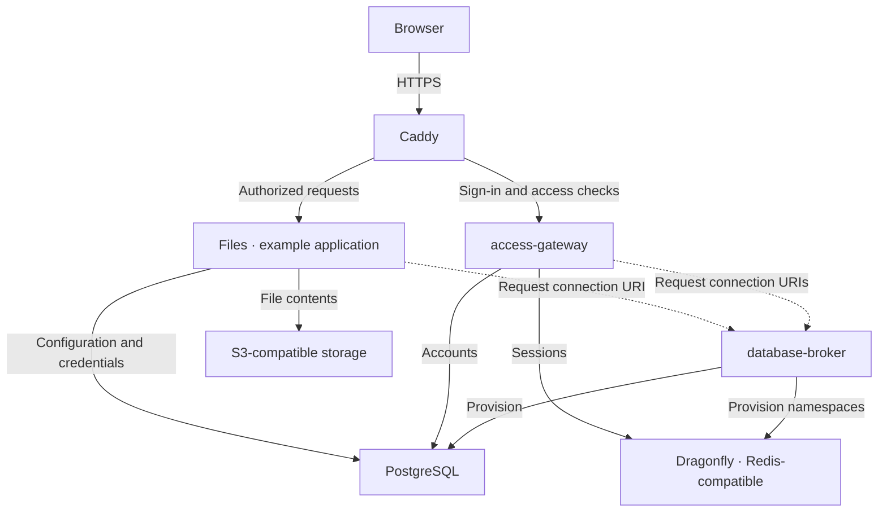

# razzie-cloud

A self-hosted platform built around two shared services: **database-broker** for
database provisioning and **access-gateway** for passkey sign-in. Applications
plug into both; Docker Swarm and Caddy bring them together.



The broker returns credentials at startup; applications then connect directly
to their databases. It stays on the private network.

## The cornerstone duo

- **[database-broker](https://github.com/razzie-cloud/database-broker)** creates
  per-service PostgreSQL databases and Dragonfly/Redis namespaces on demand.
  Services fetch a connection URI from its internal HTTP API, keeping backend
  provisioning in one place.
- **[access-gateway](https://github.com/razzie-cloud/access-gateway)** provides
  passkey accounts, device enrollment links, user management, and shared sign-in
  through Caddy forward authentication. PostgreSQL holds accounts; Redis holds
  sessions. Protected applications receive verified user identity headers.

**[Files](https://github.com/razzie-cloud/files)** shows the pattern: it gets its
database from the broker and user identity from the gateway. It adds an S3 file
manager, optional rclone encryption, and read-only share links on a separate
public hostname.

## Infrastructure and deployment

**[infra](https://github.com/razzie-cloud/infra)** contains the Docker Swarm stack,
deployment tooling, and NixOS host configuration. Caddy Docker Proxy handles
HTTPS and routing from service labels. The `web` overlay carries ingress traffic;
the `internal` overlay connects services to the broker and data stores. Database
passwords use Docker secrets. Dozzle provides administrator-only container logs.

To deploy, prepare an initialized Swarm, DNS pointing at the host, and a Docker
context targeting that Swarm (`razcloud` by default). Then:

```sh
git clone https://github.com/razzie-cloud/infra.git
cd infra
cp .env.example .env
# Select published image tags in .env.
# For your domain, update Caddy labels, origins, RP_ID, and allowed app origins.
make config   # Validate without deploying
make deploy   # Create missing database secrets and deploy the stack
```

Service release tags publish container images to GHCR; deployment selects those
tags in the ignored `.env` file. On first start, use the gateway's one-time
bootstrap token from its logs to create the administrator and enroll a passkey.

See the [deployment guide](https://github.com/razzie-cloud/infra#readme) for host,
domain, and configuration details, or the
[parent repository](https://github.com/razzie/razcloud#readme) for the complete
local Docker Compose demo.
